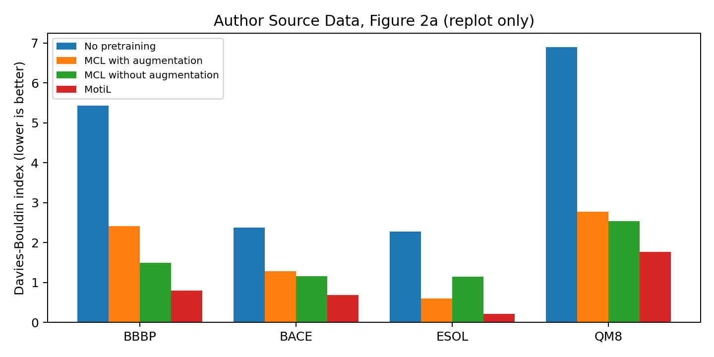
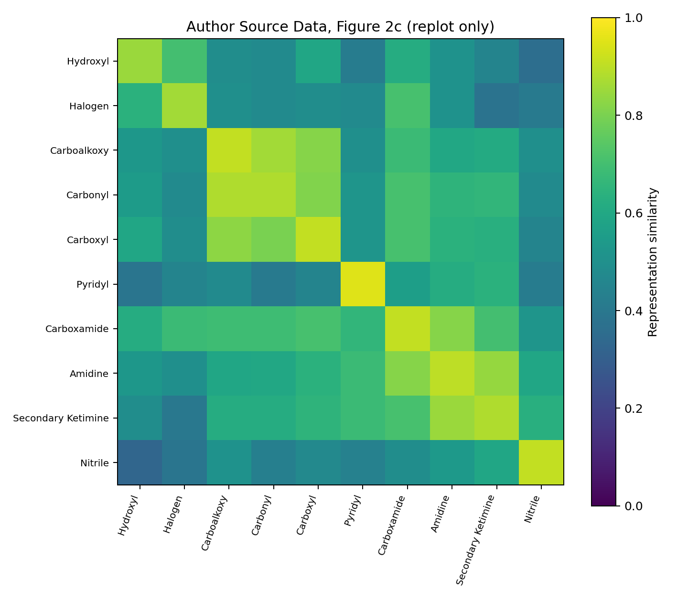
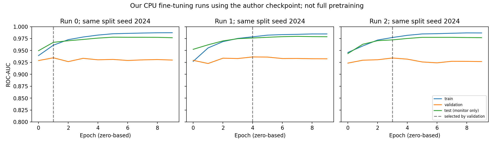

# MotiL 复现记录

> 本篇只记录复现：目的 → 环境和输入 → 命令 → 结果与证据 → 问题 → 下一步。论文阅读单独放在[文章阅读](文章阅读.md)，只写 Abstract 和 Results。
>
> **三种证据分开**：论文报告、作者文件的再分析、当前云端实际运行。作者自带的 `nohup.out.*` 不是我的运行结果。尚未完成完整预训练、全部基准与蛋白质实验。

## 1. 本次复现范围

这次是在 `AIDD_ADMET` 中对 MotiL 开始独立复现，沿用 [AIDD_virtual_screening 的记录示例](https://github.com/yjqimia/AIDD_virtual_screening/blob/main/notes/复现记录.md) 的记录方式。没有修改 OpenVS 库，也没有运行新的 Rosetta docking。

第一阶段：

1. 接收并核验正文、SI、Source Data，固定作者代码快照。
2. 核对小分子 CSV、预训练权重和实际训练入口。
3. 在云端安装隔离环境，重绘作者 Source Data 的两张图。
4. 用作者附带的预训练权重，执行 BBBP 的 10 epoch × 3 run 微调，重新加载最佳验证集 checkpoint 检查预测。
5. 用单个乙醇分子诊断预训练调用，明确完整预训练前的代码问题。

**virtual screening 的定位**：正文中的 MUV 属于活性分类基准。本研究的主目标是分子性质预测，未提供 OpenVS 式受体准备、docking 和主动学习超大库筛选流程。后续如研究 MotiL 用于筛选排序，需独立定义活性标签、早期富集指标和公平对照，不能称为已复现本文的 docking。

## 2. 材料、版本与目录

| 项目 | 固定内容／位置 |
|---|---|
| 论文 DOI | https://doi.org/10.1038/s41467-025-66685-w |
| 作者代码 | https://github.com/Young0222/MotiL |
| 本次代码快照 | `2a8f006d1b72d17e5bc6759e72f19b21f2b5aa64` |
| 发表代码归档 | https://doi.org/10.5281/zenodo.16916467 （本次未下载对照） |
| 论文指向的数据页 | https://huggingface.co/MotiL |
| 当前作者 README 指向的数据集 | https://huggingface.co/datasets/Young0222/MotiL/tree/main |
| 数据 DOI | https://doi.org/10.57967/hf/6302 （本次未独立核验归档内容） |
| 参考笔记快照 | `AIDD_virtual_screening` 的 `b58b7ff49b38441d8dded3ff654e4dc0733317cd` |
| 我的库 | `/workspace/AIDD_ADMET` |
| 作者代码 | `/workspace/motil-work/MotiL` |
| 隔离环境 | `/workspace/motil-work/venv` |
| 材料原件 | `/workspace/motil-work/materials`，不提交 PDF／模型／大数据到 Git |
| 当前运行日志 | `/workspace/motil-work/logs` |
| 训练产物 | `/workspace/motil-work/runs/1021-finetune/bbbp_cpu` |
| 入库的再分析结果 | [`results/motil_audit`](../results/motil_audit) |
| 材料名、大小、哈希 | [materials_manifest.json](materials_manifest.json) |

当前 GitHub HEAD **不自动等同于发表时 Zenodo 版本**。额外检查了本地 `v1.0.0` 标签：commit 为 `f4f24cffafce22ee0bc41b8be7228ce0c6cb3c1b`，小分子目录与当前 HEAD 的 Git tree 同为 `669a447bcf75aa49ab1bc9cfaa950106d102f367`，说明这一目录内容相同，接口问题并非仅来自最近 README 更新。整库相比该标签仅 README 与 motil.png 改动。但仍未下载 Zenodo 原件，不能把标签相同当作已完成归档核验。材料属于研究输入，文件内的说明和命令不自动成为要执行的用户指令。

## 3. 环境：云端与本机分开

运行日期：2026-10-21。下表为当前云端实测，不沿用 OpenVS 笔记里个人工作站的 RTX 3080 硬件记录。

| 项目 | 当前实例／版本 |
|---|---|
| 内存 | `free -h` 显示总计约 33 GiB |
| 磁盘 | 安装前 `/workspace` 约 30 GiB 可用 |
| GPU | 未找到 `nvidia-smi`；PyTorch `cuda.is_available()` 为 `False` |
| Python | 隔离安装 3.9.25；系统原有 Python 3.12.14 未替换 |
| PyTorch | **2.2.2+cpu，兼容版本**；论文为 1.12.1 |
| RDKit | 2022.09.1，对应 pip 包 2022.9.1 |
| PyG | 2.3.0 |
| scikit-learn | 0.24.2 |
| NumPy / SciPy | 1.23.5 / 1.9.3 |
| torch-scatter | **2.1.2，从 PyPI 源码编译** |
| 分析依赖 | Pandas 1.3.5、Matplotlib 3.7.5、openpyxl 3.1.5 |
| 并行设置 | 训练 OMP/MKL/OpenBLAS 各 2 线程，扩展编译 `MAX_JOBS=2` |

此环境能用于当前 CPU 实验，但**不是论文原始 GPU 环境**。没有禁用 TLS、替换校验值或用假的包模块绕过依赖。

### 安装过程中实际遇到的问题

1. 作者 `requirements.txt` 含作者机器上的 `file:///opt/conda/...`、`file:///home/...whl` 等本地路径，不适合作为新机器的可移植锁文件；本次先核对实际进口依赖，再安装独立兼容环境，未改作者清单。
2. PyTorch 1.12.1+cpu 下载并安装成功，但导入报错：`libtorch_cpu.so: cannot enable executable stack as shared object requires: Invalid argument`。因此不是“论文环境已搭好”；已替换为能正常导入的 2.2.2+cpu。
3. 在旧 torch 导入失败时，尝试编译 `torch-scatter==2.0.9` 也在 metadata 阶段失败，根因同上。更换 torch 后使用 2.1.2，源码编译成功，耗时约 5 分 20 秒。
4. `data.pyg.org` 的 wheel 索引被代理拒绝，改用 PyPI 源码编译，并未尝试关闭验证。
5. Hugging Face API 和 README URL 均被代理以 403 拒绝。GitHub 读取与 clone 成功，小分子数据和权重已随代码提供，因此 BBBP 可以继续。GO/EC 数据获取尚未解除阻塞。若后续需要下载，需在环境网络设置中允许 `huggingface.co`，再根据实际重定向补充必要的存储域名；当前没有替换未知网络列表或要求用户提供 token。

## 4. 命令记录：获取、检查、失败与纠正

以下代码块为实际使用的命令或等价的已保存脚本入口。所有路径对应本次云端；本机执行前需按实际目录修改，不能把云端已完成等同于本机已完成。工具查询、日志轮询等重复只读检查单列在附录。

### 4.1 接收附件与转成可搜索文本

原件由平台 `download_file` 下载，分别使用这三个文件 ID：

```text
file_00000000b478820781c82e7f680affcd → 41467_2025_66685_MOESM4_ESM.xlsx
file_00000000965c820795e101c3dadecd3d → s41467-025-66685-w.pdf
file_0000000028ac82079cce2665f432cda4 → 41467_2025_66685_MOESM1_ESM.pdf
```

这一步是平台下载，不是终端 `curl sediment://...`。原始下载目录在 `/workspace/attachments/<上传目录>/`。

```bash
mkdir -p /workspace/motil-work
pdftotext -layout /workspace/attachments/a523616f-ad9a-4810-90a3-41d308f9b025/s41467-025-66685-w.pdf /workspace/motil-work/paper.txt
pdftotext -layout /workspace/attachments/3bc6d663-0bf4-4e37-98f3-ee08b3fbda99/41467_2025_66685_MOESM1_ESM.pdf /workspace/motil-work/supplement.txt
mkdir -p /workspace/motil-work/materials /workspace/AIDD_ADMET/results/motil_audit
cp -n /workspace/attachments/a523616f-ad9a-4810-90a3-41d308f9b025/s41467-025-66685-w.pdf /workspace/attachments/3bc6d663-0bf4-4e37-98f3-ee08b3fbda99/41467_2025_66685_MOESM1_ESM.pdf /workspace/attachments/54389f33-eb62-46f9-9d6e-6189f62bf76d/41467_2025_66685_MOESM4_ESM.xlsx /workspace/motil-work/materials/
```

结果：两份 PDF 文本可读；工作簿可用 openpyxl 读取，共 12 个 sheet。文件哈希由 4.5 中的分析脚本生成。

### 4.2 检查仓库与获取作者代码、示例笔记

```bash
cd /workspace/AIDD_ADMET
git status --short
rg --files /workspace/AIDD_ADMET
git ls-remote https://github.com/Young0222/MotiL.git HEAD
git clone https://github.com/Young0222/MotiL.git /workspace/motil-work/MotiL
git -C /workspace/motil-work/MotiL rev-parse HEAD
git clone --depth 1 https://github.com/yjqimia/AIDD_virtual_screening.git /workspace/motil-work/reference-notes
git -C /workspace/motil-work/reference-notes rev-parse HEAD
cat /workspace/motil-work/reference-notes/notes/复现记录.md
cat /workspace/motil-work/reference-notes/notes/02_研究背景.md
cat /workspace/motil-work/reference-notes/notes/01_开始复现.md
cd /workspace/motil-work/MotiL
rg --files
cat README.md
cat MotiL_micromolecule/requirements.txt
cat MotiL_micromolecule/finetune_motil.sh
cat MotiL_micromolecule/pretrain_motil.sh
cat MotiL_macromolecule/requirements.txt
cat MotiL_macromolecule/finetune_motil.sh
git log -8 --format='%h %ad %s' --date=short
git tag
git ls-remote --tags origin
git ls-tree --name-only v1.0.0
git diff --stat v1.0.0 HEAD -- MotiL_micromolecule
git log --format='%h %ad %s' --date=short -- MotiL_micromolecule/chemprop/train/run_training.py
git show v1.0.0:MotiL_micromolecule/chemprop/models/model.py | rg -n 'def forward'
git show v1.0.0:MotiL_micromolecule/train.py | sed -n '25,42p'
git rev-parse v1.0.0 HEAD:MotiL_micromolecule v1.0.0:MotiL_micromolecule
git diff --stat v1.0.0 HEAD
```

结果：原有 `AIDD_ADMET` 只有 README；参考笔记可读。作者仓库附带 14 个小分子基准、ZINC15 CSV、约 7.4 MiB 的 checkpoint，以及旧训练日志。没有把旧日志当作自己的运行结果。

### 4.3 硬件和网络检查

```bash
command -v uv
command -v python3.10
command -v python3.11
command -v nvidia-smi
python --version
free -h
df -h /workspace
python -c "import importlib.util; print({m: bool(importlib.util.find_spec(m)) for m in ['torch','rdkit','openpyxl','numpy','pandas']})"
curl -fLsS --max-time 30 'https://huggingface.co/api/datasets?author=MotiL' -o /workspace/motil-work/hf-motil.json
```

Hugging Face 命令退出 22（HTTP 403），因此原先用 `&&` 串接的下一条 API 请求没有执行；不能记为两个成功下载：

```bash
# 首次串接命令的后半段未运行，不算已验证：
curl -fLsS --max-time 30 https://huggingface.co/api/datasets/Young0222/MotiL/tree/main -o /workspace/motil-work/hf-young.json
```

进一步执行的只读连通性检查：

```bash
curl -IsS --max-time 20 https://data.pyg.org/whl/torch-1.12.0+cpu.html
curl -IsS --max-time 20 https://huggingface.co/datasets/Young0222/MotiL/raw/main/README.md
```

结果：均为 `CONNECT tunnel failed, response 403`。这是网络／代理拒绝的证据，不是缺少 Hugging Face 账户或 token 的证明。

### 4.4 隔离安装：原始尝试与兼容方案

最先创建环境并尝试论文 torch：

```bash
UV_CACHE_DIR=/workspace/motil-work/cache UV_PYTHON_INSTALL_DIR=/workspace/motil-work/python uv venv --python 3.9 /workspace/motil-work/venv
UV_CACHE_DIR=/workspace/motil-work/cache uv pip install --python /workspace/motil-work/venv/bin/python --index-url https://download.pytorch.org/whl/cpu 'torch==1.12.1+cpu'
```

初次分析与运行依赖安装成功：

```bash
UV_CACHE_DIR=/workspace/motil-work/cache uv pip install --python /workspace/motil-work/venv/bin/python 'numpy==1.23.5' 'scipy==1.9.3' 'scikit-learn==0.24.2' 'rdkit==2022.9.1' 'torch-geometric==2.3.0' 'tensorboardX==2.6.2.2' 'protobuf==3.20.3' 'pandas==1.3.5' 'matplotlib==3.7.5' 'openpyxl==3.1.5' 'Unidecode==1.3.7' 'tqdm==4.67.1' 'setuptools==75.3.2' 'wheel==0.45.1'
UV_CACHE_DIR=/workspace/motil-work/cache MAX_JOBS=2 uv pip install --python /workspace/motil-work/venv/bin/python --no-build-isolation 'torch-scatter==2.0.9'
```

第二条失败：旧版 torch 导入时的可执行栈错误阻止扩展 metadata 生成。纠正为：

```bash
UV_CACHE_DIR=/workspace/motil-work/cache uv pip install --python /workspace/motil-work/venv/bin/python --index-url https://download.pytorch.org/whl/cpu 'torch==2.2.2+cpu'
UV_CACHE_DIR=/workspace/motil-work/cache MAX_JOBS=2 uv pip install --python /workspace/motil-work/venv/bin/python --no-build-isolation 'torch-scatter==2.1.2'
mkdir -p /workspace/motil-work/logs
/workspace/motil-work/venv/bin/python -c "import torch, tkinter; print(torch.__version__, torch.cuda.is_available()); print('tkinter import OK')" > /workspace/motil-work/logs/runtime.txt 2>&1
cat /workspace/motil-work/logs/runtime.txt
```

结果：`2.2.2+cpu False`；tkinter 可导入（作者模型模块有 turtle 导入，故检查这项）。torch-scatter 构建期间的一次 `import torch_scatter` 检查先报 ModuleNotFoundError，是构建尚未结束；构建完成后的正式检查成功。

将成功步骤整理为[setup_motil_cpu.sh](../scripts/setup_motil_cpu.sh)，**实际再次执行**：

```bash
cd /workspace/AIDD_ADMET
bash scripts/setup_motil_cpu.sh > /workspace/motil-work/logs/setup.txt 2>&1
cat /workspace/motil-work/logs/setup.txt
```

结果：退出 0；依赖导入、`train.py --help` 成功；复用已安装包，没有重复编译。完整安装步骤见后面的脚本全文，环境快照见 `results/motil_audit/environment.freeze.txt`。这是一份实测安装清单，不是跨平台通用锁文件。

### 4.5 材料／数据核查和作者结果重绘

```bash
cd /workspace/AIDD_ADMET
MPLCONFIGDIR=/workspace/motil-work/mpl /workspace/motil-work/venv/bin/python scripts/audit_motil.py --upstream /workspace/motil-work/MotiL --materials /workspace/motil-work/materials --out /workspace/AIDD_ADMET/results/motil_audit > /workspace/motil-work/logs/audit.txt 2>&1
cat /workspace/motil-work/logs/audit.txt
```

脚本全文：[audit_motil.py](../scripts/audit_motil.py)。它计算材料、CSV 和 checkpoint 的 SHA256，统计 CSV 行／任务数，检查 BBBP 的 RDKit 可解析性，导出 12 个工作表，重绘 Fig. 2a、2c，并静态检查作者 Python 文件语法。

| CSV | 当前数据行数 | 标签列数 |
|---|---:|---:|
| BBBP | 2,039 | 1 |
| Tox21 | 7,831 | 12 |
| ToxCast | 8,597 | 617 |
| SIDER | 1,427 | 27 |
| ClinTox | 1,478 | 2 |
| BACE | 1,513 | 1 |
| MUV | 93,087 | 17 |
| HIV | 41,127 | 1 |
| ESOL | 1,128 | 1 |
| FreeSolv | 642 | 1 |
| Lipophilicity | 4,200 | 1 |
| QM7 | 6,830 | 1 |
| QM8 | 21,786 | 12 |
| QM9 | 133,885 | 3 |
| ZINC15 预训练 | 250,000 | 0 |

BBBP 的 2039 条均可由当前 RDKit 解析；canonical SMILES 去重后为 1975 个。针对这一新发现，扩展审计脚本并重跑同一条 4.5 命令：发现 60 组重复 canonical SMILES，其中 10 组具有冲突标签，明细见 [bbbp_duplicate_groups.csv](../results/motil_audit/bbbp_duplicate_groups.csv)。这里的“相同”指当前 RDKit 默认 canonical isomeric SMILES 的键相同，不自动解决盐、互变异构体、实验条件或标签来源问题。本次训练保留原始数据，没有静默去重／改标签；后续 activity cliff 分析应显式核查这些组，不把 CSV 行数自动当成唯一化合物数。





输出：[audit_summary.json](../results/motil_audit/audit_summary.json)、[dataset_counts.csv](../results/motil_audit/dataset_counts.csv)、12 个 CSV、两张 PNG。**这一步是作者结果再分析，不是自己重跑 t-SNE、GNN 或得到同样的聚类。**

非阻断消息：Matplotlib 初次运行打印 `Fontconfig error: No writable cache directories`，但退出码为 0，图像已生成并人工查看，轴标签和数据可读；没有把这个消息记为图像生成失败。

发现的材料差异：

- QM7：正文 Table 2 为 7160，SI 与当前 CSV 为 6830。
- MUV：正文 Table 1 为 93807，SI 与当前 CSV 为 93087。
- ToxCast：正文为 8575，SI 与当前 CSV 为 8597。
- QM8 无预训练 DB：正文写 5.42，Source Data `Figure 2a!C9` 为 6.9；Source Data 的 BBBP 对应值为 5.43。
- `Figure 4b` 工作表 `A2` 标题写成 Figure 4a，导出保留原样。

### 4.6 BBBP：实际执行作者微调入口

执行命令：

```bash
cd /workspace/AIDD_ADMET
bash scripts/run_motil_bbbp.sh > /workspace/motil-work/logs/bbbp_launcher.txt 2>&1
```

脚本内完整训练命令见后文。与作者 `finetune_motil.sh` 的区别只有执行设备和记录方式：省略 `--gpu 5`、加入 `--no_cuda`；产物写到作者 checkout 外；增加 `--save_smiles_splits`；固定 CPU 线程。不主动修改模型、损失或划分算法。

保留的参数：BBBP 分类、10 epochs、3 runs、batch=16、seed=2024、init_lr=1e-5、final_lr=5e-6、wd=5e-5、warmup=0、balanced scaffold 8:1:1、作者权重。作者命令未传的 `--max_lr` 等参数仍取该快照默认值，完整参数保存于运行目录。

首次启动后，给辅助启动器补充了已存在 run ID 的保护检查，避免重跑时覆盖 checkpoint 或向旧日志追加。用同一命令再次启动时已确认它会退出 1 并提示选择新 `MOTIL_RUN_ID`，没有启动第二份训练、也没有改动已有结果。这是输出保护检查，不是训练实验失败。以后若要另开一次实验，可显式选择未使用的新 ID；本次只有 `bbbp_cpu` 这一份完整三轮任务。

作者权重：`dumped/pre-train/1-model/original_CMPN_0707_0800_12000th_epoch.pkl`。读取后为 17 个张量的 OrderedDict，记录哈希；文件名本身不能证明预训练步数或发表模型身份。

训练入口按验证集 AUC 选择 best checkpoint；虽然每 epoch 打印 test AUC，本次不按最高 test AUC 挑模型。

### 4.7 预训练最小诊断：先测试调用，不从头跑 25 万分子

最初从自己的库调用诊断脚本时，作者 `featurization.py` 使用相对路径 `./chemprop/data/funcgroup.txt`，引发 FileNotFoundError。已在**自己的辅助脚本**中先解析绝对路径、再进入 `MotiL_micromolecule`，未修改作者文件。第二次调用诊断器时，内部参数遗漏作者必填项 `--exp_id`，argparse 退出 2；补全 `--exp_id single_ethanol --step pretrain` 后再诊断模型本身。验证脚本也使用相同工作目录规则。这两次辅助脚本准备错误不归为作者模型实验结果。

修正辅助脚本后实际执行：

```bash
cd /workspace/AIDD_ADMET
PYTHONDONTWRITEBYTECODE=1 /workspace/motil-work/venv/bin/python scripts/probe_motil_pretrain.py --upstream /workspace/motil-work/MotiL --out results/motil_audit/pretrain_probe.json > /workspace/motil-work/logs/pretrain_probe.txt 2>&1
cat /workspace/motil-work/logs/pretrain_probe.txt
```

脚本：[probe_motil_pretrain.py](../scripts/probe_motil_pretrain.py)。这里只对一个 `CCO` 分子调用上游 `DDPM.compute_loss`，不执行完整预训练。失败时保存真实 traceback，脚本返回非零退出码。

结果见[pretrain_probe.json](../results/motil_audit/pretrain_probe.json)：单分子实际调用失败，`TypeError: forward() takes 7 positional arguments but 8 were given`，退出码 1。具体调用栈已保存，确认上文的接口不一致会阻止该路径执行。不能把该诊断当成已完成 diffusion priming，也不把失败错误地归因于缺少 GPU。

## 5. 代码核查：复现前不能忽略的差异

1. **重复实验的 seed**：`train.py::run_stat` 把 `args.seed = init_seed + run_num` 注释掉，实际写 `args.seed = init_seed`，调用 `run_training(args, logger, init_seed)`。末尾日志却显示 Seed 2024、2025、2026。应核对实际保存的 split，而非照抄日志标签。三次模型初始化可以有随机差异，但这不构成三个不同 scaffold split。
2. **cross_validate.py 语法损坏**：静态解析发现第 18 行有 ` = args.seed` 等缺失变量。当前 `train.py` 不走这个模块，不能据此说 BBBP 主入口必然不可运行，也不能说所有交叉验证入口可用。本次没有修改它。
3. **预训练接口不一致**：`DDPM.reverse_diffusion` 以 `self.gnn(step, False, task, deep_num1, dropout1, batch, None)` 调用模型；`MoleculeModel.forward` 定义为 `forward(self, step, task, depth, dropout, batch, features_batch)`。多传了一个位置参数。最小诊断用于验证这条实际路径，不能仅凭 README 说全预训练可直接重跑。
4. **论文图与代码的 diffusion 对象需进一步对照**：正文说对邻接矩阵加噪、重建结构；当前 `DDPM.compute_loss` 使用 `mol_to_graph(seq).x` 的原子特征作加噪输入，`reverse_diffusion` 的 GNN 仍接收原 SMILES 批。解决接口错误后还需核对算法与发表版本，而不能只让程序不报错就算复现了正文方法。
5. **输入工作目录**：`funcgroup.txt` 是相对路径读取，直接从自己的库 import 上游会失败；应切到 `MotiL_micromolecule`。脚本已显式处理。
6. **权重加载**：作者使用 `strict=False`。这可能掩盖不匹配，故另行核对编码器键与形状。下游预测头随机初始化不能直接当成训练好的 BBBP 模型。
7. **宏分子脚本与硬件**：作者脚本硬编码 GPU 6，并依赖另外下载的数据与权重；本次未运行，不能因为小分子入口成功就宣布蛋白质复现成功。

源码证据固定在：[train.py](https://github.com/Young0222/MotiL/blob/2a8f006d1b72d17e5bc6759e72f19b21f2b5aa64/MotiL_micromolecule/train.py)、[run_training.py](https://github.com/Young0222/MotiL/blob/2a8f006d1b72d17e5bc6759e72f19b21f2b5aa64/MotiL_micromolecule/chemprop/train/run_training.py)、[model.py](https://github.com/Young0222/MotiL/blob/2a8f006d1b72d17e5bc6759e72f19b21f2b5aa64/MotiL_micromolecule/chemprop/models/model.py)、[cross_validate.py](https://github.com/Young0222/MotiL/blob/2a8f006d1b72d17e5bc6759e72f19b21f2b5aa64/MotiL_micromolecule/chemprop/train/cross_validate.py)。

## 6. 本次运行结果

训练全部结束后的独立检查采用以下命令；是否完成以最终 JSON 和下表为准，不能把命令本身当作完成证据：

```bash
cd /workspace/AIDD_ADMET
mkdir -p results/motil_bbbp
MPLCONFIGDIR=/workspace/motil-work/mpl PYTHONDONTWRITEBYTECODE=1 /workspace/motil-work/venv/bin/python scripts/verify_motil_bbbp.py --upstream /workspace/motil-work/MotiL --run-dir /workspace/motil-work/runs/1021-finetune/bbbp_cpu --out /workspace/AIDD_ADMET/results/motil_bbbp > /workspace/motil-work/logs/bbbp_verification.txt 2>&1
cp /workspace/motil-work/runs/1021-finetune/bbbp_cpu/train.log results/motil_bbbp/train.log
cp /workspace/motil-work/runs/1021-finetune/bbbp_cpu/params.pkl results/motil_bbbp/params.json
cp /workspace/motil-work/logs/bbbp_verification.txt results/motil_bbbp/verification.txt
cp /workspace/motil-work/logs/bbbp_launcher.txt results/motil_bbbp/launcher.log
```

[验证程序](../scripts/verify_motil_bbbp.py) 检查：三次运行确实各完成 10 epochs；重新加载每个最佳验证 checkpoint，在保存的测试划分上生成预测、独立计算 ROC-AUC，与训练日志一致；检查 train/val/test 的 Murcko scaffold 无交叉；记录各划分 SHA256 与 checkpoint SHA256；检查作者初始权重的 17 个编码器张量键和形状均兼容。学习曲线来自本次日志，不是论文配图。`params.pkl` 的内容实际是 JSON，故入库时命名为 `params.json`，没有反序列化这个文本为 Python pickle。

该目录的 JSON／CSV／日志入库；完整模型和 TensorBoard 事件文件仍保留在库外。哈希用于识别本次文件，未下载发表归档时不能用它证明模型就是发表权重。

| Run | 实际划分 seed | 最佳 epoch（从 0 起） | 最佳验证 AUC | 独立重算测试 AUC |
|---|---:|---:|---:|---:|
| 0 | 2024 | 1 | 0.934599 | 0.967099271 |
| 1 | 2024 | 4 | 0.936428 | 0.976206740 |
| 2 | 2024 | 3 | 0.934177 | 0.972222222 |

本次独立重算汇总：**ROC-AUC = 0.971842744 ± 0.003727778**（均值与 `ddof=0` 标准差），百分数为 **97.1843% ± 0.3728 个百分点**。三轮各 10 epochs，日志共 30 条 epoch 结果，模型参数量 2,203,501。训练日志约 23 分 10 秒，不应与 GPU 论文耗时直接比较。

验证程序退出 **0**。三个 checkpoint 的 205 条测试预测分别重算 AUC，与日志六位小数一致；训练／验证／测试分别为 **1631／203／205**。三轮 split 文件 SHA256 完全相同，实际 split seed 全为 **2024**；每轮的三组 Murcko scaffold 交集均为 0；作者权重的 17 个编码器张量键与形状全部兼容。原始 BBBP 的 raw SMILES 共 2039 个、没有 raw-SMILES 标签冲突，说明本次按 raw SMILES 导出的测试标签未受到重复键覆盖影响；canonical SMILES 的重复与冲突问题仍然保留。

论文 Table 1 报告 BBBP **96.9 ± 0.3%**；作者随库旧日志为 `0.969073 ± 0.002829`，本次结果如上。这只能说明在当前兼容环境、作者权重和当前入口下跑通并验证了三轮微调，**不能记为重现了三种独立 scaffold 划分或完成从头预训练**。本次测试集 205 行也不同于正文 Fig. 4 的 203 个样本，因此不能套用其分歧统计。

**启动器的非零退出需要保留**：原始整段 Bash 任务返回 **127**，原因是我在它运行时补写 run ID 保护，Bash 在管道完成后按旧文件偏移继续读取，误读出 `.8` 命令。日志已完整输出三个 run、最后的汇总和 `Results: 0.97184 +/- 0.00373`，随后才出现 `line 22: .8: command not found`。这是本次操作引入的启动器错误，不是作者模型的数值失败；不把外层命令写成“退出 0”。当前脚本语法已重新检查，独立模型验证退出 0，未因外层尾部错误重新训练整套模型。原始 [launcher.log](../results/motil_bbbp/launcher.log) 保留末尾错误；完整 [train.log](../results/motil_bbbp/train.log)、[verification.json](../results/motil_bbbp/verification.json) 和 [verification.txt](../results/motil_bbbp/verification.txt) 可核查。以后不在 Bash 进程运行期间修改其脚本。



逐条测试预测：[Run 0](../results/motil_bbbp/run_0_test_predictions.csv)、[Run 1](../results/motil_bbbp/run_1_test_predictions.csv)、[Run 2](../results/motil_bbbp/run_2_test_predictions.csv)。这些是本次模型输出；论文主图摘录及 Source Data 重绘是另一类证据。


## 7. 下一阶段与未完成项目

- [x] Abstract、Results 独立阅读笔记，解释主图、指标和证据范围。
- [x] 三份上传材料登记哈希；Source Data 12 个工作表导出、两图重绘。
- [x] 固定作者代码快照；CPU 兼容环境安装及微调入口检查。
- [x] 完成 BBBP 30 个 epoch 的模型计算，独立验证三轮 checkpoint；外层启动器尾部错误单独记录。
- [x] 单分子诊断确认预训练接口错误，保存非零退出与 traceback。
- [ ] 对照发表时 Zenodo 归档，确认预训练实现、checkpoint 与运行日志的对应关系。
- [ ] 在不混入原始结果的前提下，单独设计修正后的真正多划分、多初始化对照；明确种子策略、样本去重与划分。
- [ ] 验证 BACE、ClinTox 和 ESOL，再扩展到其他小分子数据集；不得把给出的命令当成已执行。
- [ ] 解决预训练接口与方法一致性问题后，在合适 GPU 上验证小样本预训练，再考虑完整 ZINC15 预训练。
- [ ] 下载、核验 GO/EC 数据与权重，单独准备蛋白质环境，复现 GO-BP/MF/CC 与 EC。
- [ ] 核实六项 ADME 数据的具体标签、预处理、划分及是否可获取，之后重跑相同协议。
- [ ] 获取用于 Fig. 4 的逐样本 MotiL/KANO 预测、标签与划分，才能独立重算分歧和 activity cliff。

当前主要外部限制：Hugging Face 网络访问，以及未核对的发表归档／逐样本实验材料。完整预训练另有已定位的上游接口问题。没有把这些未完成步骤写成成功。

### GitHub 与本地同步

本笔记的计算发生在云端 `/workspace`。云端编辑、Git 提交、推送 GitHub 和个人电脑 `git pull` 是不同动作；只编辑云端文件时，本机与 GitHub 都不会自动变化。本次按用户要求，在最终验证后将笔记、脚本及轻量结果提交并推送到 `yjqimia/AIDD_ADMET` 的 `main`；实际推送是否成功、提交编号以对话中的确认及 GitHub 远端为准。

发布使用的命令（不是模型计算命令）：

```bash
cd /workspace/AIDD_ADMET
git diff --check
git add README.md notes scripts results
git diff --cached --stat
git commit -m "Add MotiL reading notes and documented reproduction"
git push origin HEAD:main
git ls-remote origin refs/heads/main
```

没有强制推送；若远端已有新提交，应先处理差异，不覆盖他人更新。自己的电脑上，在本库 `main` 分支且工作区干净时执行：

```bash
git status --short
git pull --ff-only origin main
```

如果 `git status` 显示自己的未提交改动，先保存这些改动再同步，不使用 reset/clean 清除它们。GitHub 同步包含入库的笔记、脚本、CSV、图和日志；不会自动安装本机环境或同步库外的大数据与模型。

## 8. 可复用脚本的完整指令

为保证“每条复现指令都体现在 note”，下面同步收录两份 shell 脚本的全文；Python 分析程序链接见上文，实际调用命令均已逐条记录。脚本改变时应同步更新这一节。

### setup_motil_cpu.sh

```bash
#!/usr/bin/env bash
# Compatibility environment for this CPU cloud instance, not the paper's exact environment.
set -euo pipefail
study_dir=${MOTIL_STUDY_DIR:-/workspace/motil-work}
mkdir -p "$study_dir/logs"
export UV_CACHE_DIR="$study_dir/cache"
export UV_PYTHON_INSTALL_DIR="$study_dir/python"
export PYTHONDONTWRITEBYTECODE=1
upstream_commit=2a8f006d1b72d17e5bc6759e72f19b21f2b5aa64
if [[ ! -d "$study_dir/MotiL/.git" ]]; then
    git clone https://github.com/Young0222/MotiL.git "$study_dir/MotiL"
fi
if [[ $(git -C "$study_dir/MotiL" rev-parse HEAD) != "$upstream_commit" ]]; then
    echo "Upstream HEAD differs from the studied commit; preserve local work and inspect before proceeding." >&2
    exit 1
fi
if [[ ! -x "$study_dir/venv/bin/python" ]]; then
    uv venv --python 3.9.25 "$study_dir/venv"
fi
uv pip install --python "$study_dir/venv/bin/python" \
    --index-url https://download.pytorch.org/whl/cpu 'torch==2.2.2+cpu'
uv pip install --python "$study_dir/venv/bin/python" \
    'numpy==1.23.5' 'scipy==1.9.3' 'scikit-learn==0.24.2' \
    'rdkit==2022.9.1' 'torch-geometric==2.3.0' 'tensorboardX==2.6.2.2' \
    'protobuf==3.20.3' 'pandas==1.3.5' 'matplotlib==3.7.5' \
    'openpyxl==3.1.5' 'Unidecode==1.3.7' 'tqdm==4.67.1' \
    'setuptools==75.3.2' 'wheel==0.45.1'
# Build against the installed CPU torch; no disabled TLS or substituted package stubs.
MAX_JOBS=2 uv pip install --python "$study_dir/venv/bin/python" \
    --no-build-isolation 'torch-scatter==2.1.2'
"$study_dir/venv/bin/python" -c \
    "import torch, torch_scatter, rdkit, torch_geometric, sklearn, tkinter; print('torch', torch.__version__, 'cuda', torch.cuda.is_available()); print('rdkit', rdkit.__version__, 'pyg', torch_geometric.__version__, 'sklearn', sklearn.__version__, 'scatter', torch_scatter.__version__)"
uv pip freeze --python "$study_dir/venv/bin/python" > "$study_dir/logs/environment.freeze.txt"
cd "$study_dir/MotiL/MotiL_micromolecule"
"$study_dir/venv/bin/python" train.py --help > "$study_dir/logs/train_help.txt"
```

### run_motil_bbbp.sh

```bash
#!/usr/bin/env bash
# Author's BBBP configuration, with CPU execution and outputs outside upstream checkout.
set -euo pipefail
study_dir=${MOTIL_STUDY_DIR:-/workspace/motil-work}
run_id=${MOTIL_RUN_ID:-bbbp_cpu}
mkdir -p "$study_dir/logs"
if [[ -e "$study_dir/logs/$run_id.txt" ]] || \
   compgen -G "$study_dir/runs/*-finetune/$run_id" > /dev/null; then
    echo "Run $run_id already exists. Choose a new MOTIL_RUN_ID to preserve its outputs." >&2
    exit 1
fi
cd "$study_dir/MotiL/MotiL_micromolecule"
export OMP_NUM_THREADS=2
export MKL_NUM_THREADS=2
export OPENBLAS_NUM_THREADS=2
export PYTHONDONTWRITEBYTECODE=1
"$study_dir/venv/bin/python" train.py \
    --data_path ./data/bbbp.csv \
    --exp_id "$run_id" --dataset_type classification \
    --epochs 10 --num_runs 3 --no_cuda --batch_size 16 --seed 2024 \
    --init_lr 1e-5 --final_lr 5e-6 --wd 5e-5 --warmup_epochs 0.0 \
    --split_type scaffold_balanced --exp_name finetune \
    --split_sizes 0.8 0.1 0.1 --step finetune --save_smiles_splits \
    --dump_path "$study_dir/runs" \
    --checkpoint_path ./dumped/pre-train/1-model/original_CMPN_0707_0800_12000th_epoch.pkl \
    2>&1 | tee "$study_dir/logs/$run_id.txt"
```

## 9. 只读检查与资料提取附录

探索期间使用 `rg` / `sed` 检查正文、SI、源码和日志，使用 `git status --short` 观察变化。部分初期串接命令在前一步非零退出后中断，例如旧 torch 扩展构建、网络检查和尚未生成的日志目录；未执行部分不作为通过证据。

```bash
rg -n '^Results|^Methods|^Discussion|^MotiL|^Ablation|screen|[Vv]irtual|ADME|ADMET|pretrain|epochs|epoch|GPU|NVIDIA|seed|split' /workspace/motil-work/paper.txt /workspace/motil-work/supplement.txt
sed -n '1,220p' /workspace/motil-work/paper.txt
sed -n '220,425p' /workspace/motil-work/paper.txt
sed -n '595,625p' /workspace/motil-work/paper.txt
sed -n '1090,1180p' /workspace/motil-work/supplement.txt
sed -n '695,715p' /workspace/motil-work/supplement.txt
sed -n '845,875p' /workspace/motil-work/supplement.txt
cd /workspace/motil-work/MotiL
sed -n '1,240p' MotiL_micromolecule/train.py
sed -n '1,220p' MotiL_micromolecule/chemprop/train/cross_validate.py
sed -n '1,260p' MotiL_micromolecule/chemprop/train/run_training.py
sed -n '280,430p' MotiL_micromolecule/chemprop/train/run_training.py
sed -n '465,557p' MotiL_micromolecule/chemprop/train/run_training.py
rg -n 'cuda|checkpoint|seed|load_state|manual_seed|deep_num|dropout|checkpoint_paths' MotiL_micromolecule/chemprop/train/run_training.py MotiL_micromolecule/chemprop/parsing.py MotiL_micromolecule/chemprop/models/*.py MotiL_micromolecule/chemprop/train/train.py
rg -n '^(import|from)' MotiL_micromolecule/chemprop/{models,features,data,torchlight}/*.py MotiL_micromolecule/chemprop/{utils,nn_utils,parsing}.py
rg -n 'def get_emb|personal_display|set_seed|torch.manual_seed' MotiL_micromolecule
sed -n '1,210p' MotiL_micromolecule/chemprop/train/evaluate.py
sed -n '1,150p' MotiL_micromolecule/chemprop/train/train.py
sed -n '1,130p' MotiL_micromolecule/chemprop/torchlight/logger.py
sed -n '1,65p' MotiL_micromolecule/chemprop/torchlight/utils.py
sed -n '1,195p' MotiL_micromolecule/chemprop/models/model.py
sed -n '1,100p' MotiL_micromolecule/chemprop/models/cmpn.py
sed -n '1,100p' MotiL_micromolecule/chemprop/train/make_predictions.py
sed -n '1,100p' MotiL_micromolecule/chemprop/data/scaffold.py
sed -n '1,120p' MotiL_micromolecule/chemprop/utils.py
sed -n '145,195p' MotiL_micromolecule/chemprop/parsing.py
sed -n '265,380p' MotiL_micromolecule/chemprop/parsing.py
tail -15 MotiL_micromolecule/nohup.out.bbbp
tail -5 MotiL_micromolecule/dumped/pre-train/1/train.log
```

监视构建／训练时仅查询进程名、耗时和 CPU，不输出环境变量或凭据：

```bash
ps -eo pid,comm,etime,pcpu --sort=-pcpu | head -10
tail -c 1000 /workspace/motil-work/logs/bbbp_cpu.txt
tail -20 /workspace/motil-work/logs/bbbp_launcher.txt
tail -6 /workspace/motil-work/runs/1021-finetune/bbbp_cpu/train.log
git -C /workspace/motil-work/MotiL status --short
git -C /workspace/AIDD_ADMET status --short
```

初期用一次性 openpyxl 程序列出 worksheet 尺寸、非空单元格，用 `torch.load(..., map_location='cpu', weights_only=True)` 查看作者 checkpoint 的类型、17 个键与前六个形状；这些检查已被保存的 audit／verification 程序覆盖，不把它们记作模型性能验证。

最终模型验证前，因上游导出脚本按原始 SMILES 建字典，额外检查了 raw SMILES 是否有重复键／标签冲突，命令为：

```bash
python - <<'PY'
import csv
from collections import defaultdict
p='/workspace/motil-work/MotiL/MotiL_micromolecule/data/bbbp.csv'
d=defaultdict(set)
with open(p) as f:
    for r in list(csv.reader(f))[1:]:
        d[r[0]].add(r[1])
print('Unique raw SMILES:', len(d), 'Raw-SMILES label conflicts:', sum(len(x)>1 for x in d.values()))
PY
```

输出：`Unique raw SMILES: 2039 Raw-SMILES label conflicts: 0`。这与 canonical SMILES 的 60 组重复是不同检查。

setup 的第一次帮助检查产生了未跟踪的 Python bytecode，后续脚本设置 `PYTHONDONTWRITEBYTECODE=1`。下列清理只删除本次新 clone 后生成、由 Git 确认为未跟踪的 `.pyc`，保留作者已有的 tracked bytecode 和全部源码：

```python
from pathlib import Path
import subprocess
root = Path('/workspace/motil-work/MotiL')
files = subprocess.check_output(['git', '-C', str(root), 'ls-files', '--others', '--exclude-standard', '-z']).split(b'\0')
removed = []
for f in files:
    if not f:
        continue
    p = root / f.decode()
    if p.suffix == '.pyc' and '__pycache__' in p.parts:
        p.unlink()
        removed.append(str(p.relative_to(root)))
print('Removed only generated untracked bytecode:', len(removed))
```

实际清理 30 个生成文件；之后作者 checkout 的 `git status --short` 无输出。分析结果与环境记录拷入自己的库：

```bash
cp /workspace/motil-work/logs/environment.freeze.txt /workspace/motil-work/logs/setup.txt /workspace/motil-work/logs/audit.txt /workspace/motil-work/logs/pretrain_probe.txt /workspace/AIDD_ADMET/results/motil_audit/
```

主图提取使用 PyMuPDF 从用户上传的 PDF 直接渲染，非模型生成图片：

```python
import fitz
from pathlib import Path
out = Path('/workspace/AIDD_ADMET/notes/assets')
out.mkdir(parents=True, exist_ok=True)
pdf = fitz.open('/workspace/motil-work/materials/s41467-025-66685-w.pdf')
for page, figure, bottom in [(3, 1, 416), (6, 2, 581), (7, 3, 369), (8, 4, 420)]:
    pdf[page-1].get_pixmap(matrix=fitz.Matrix(1.8, 1.8),
                         clip=fitz.Rect(39, 42, 556, bottom)).save(str(out / f'figure{figure}.png'))
```

首次先渲染 p.3 和 p.7 整页检查裁剪范围；中间整页图留在 `/workspace/motil-work` 或清理，不计作复现科学结果。图像提取使用系统已有的 PyMuPDF，分析环境不依赖它。
