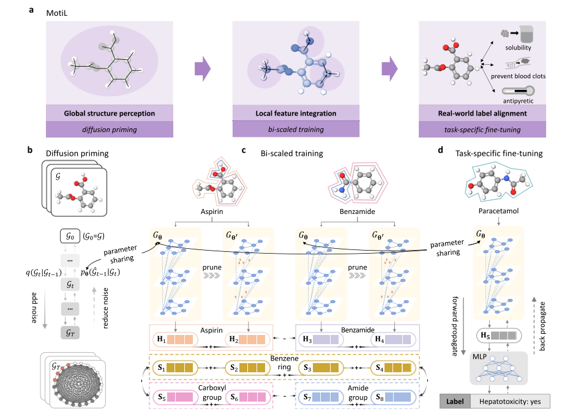
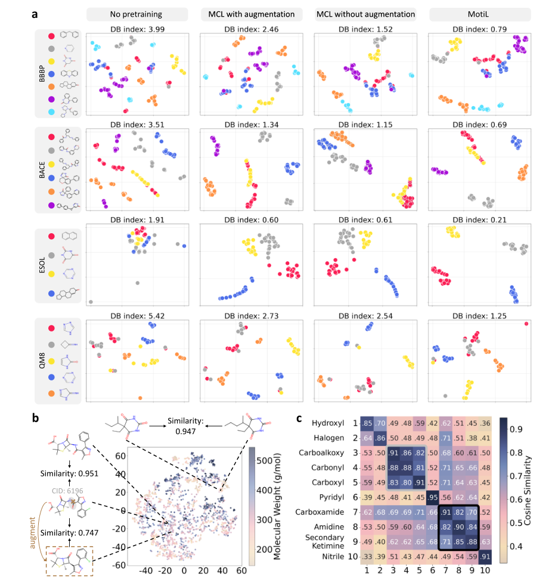
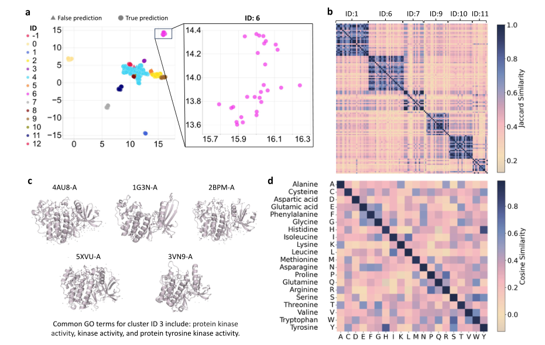
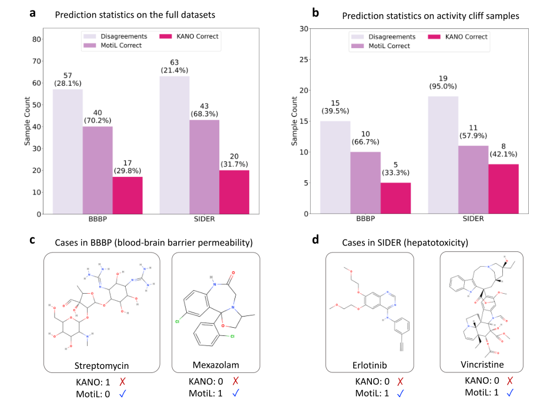

# MotiL 论文阅读笔记

> 本篇只做 **Abstract 和 Results**。复现命令、环境、代码问题及自己的运行结果另见[复现记录](复现记录.md)。下文数值均为论文或作者 Source Data 所报告，不能视作我的训练结果。
>
> 沿用 [OpenVS 示例笔记](https://github.com/yjqimia/AIDD_virtual_screening/blob/main/notes/复现记录.md) 的阅读方式：先交代问题，再按结果小节解释图表、数字与结论的适用范围。

论文：Liu, Z. et al. *Molecular Motif Learning as a pretraining objective for molecular property prediction*. Nature Communications **16**, 11676 (2025)。DOI：https://doi.org/10.1038/s41467-025-66685-w 。材料：用户上传的正文、Supplementary Information 和 Source Data Excel。

## Abstract

### 背景

> Molecular property prediction is crucial for drug discovery in biopharmaceuticals since it helps identify promising compounds, optimizing the efficacy of developing new therapies. Despite its importance, existing deep learning-based methods for this task are often incongruous with fundamental chemical properties.

分子性质预测用于判断哪些化合物值得进一步研究，例如能否穿过血脑屏障、是否有毒性、溶解度如何。作者指出，已有模型学到的表示不一定能很好反映化学结构与功能。

这里的 **representation / embedding（表示／嵌入）**，可以理解为模型把分子压缩成的一串数字。关键不是数字多，而是这些数字能否保留对目标性质有用的信息。

### 本文

> Here we show that an unsupervised pretraining approach, Molecular Motif Learning (MotiL), learns molecular representations that preserve both whole-molecule structure and motif-level information directly from native molecular graphs.

作者提出 **MotiL（Molecular Motif Learning）**：先利用没有性质标签的分子学习表示，再用有标签的数据做下游预测。重点同时保留：

- **分子整体的信息**：整张分子图的结构。
- **motif 层的信息**：小分子的官能团、蛋白质的氨基酸等局部化学单元。

“直接从原始分子图学习”主要对应第二阶段不依赖破坏分子结构的图增强；第一阶段 diffusion priming 仍然包含加噪与重建，不能理解为全过程完全不扰动图。

### 表现

> MotiL produces representations that group small molecules sharing a common core structure (i.e., scaffold) and proteins with related three-dimensional structures and functions. We evaluated MotiL on at least 16 molecule benchmarks, and uncovered that it captures analogous graph representations not only for small molecules with the same scaffold but also for protein macromolecules with similar structures and overlapping chemical functions such as tRNA binding. These informative representations empower MotiL to surpass the accuracy of state-of-the-art contrastive or predictive methods in the prediction of molecular properties like blood brain barrier permeability.

作者报告的两类证据：

1. **表示是否有化学意义？** 同骨架小分子、结构与功能相近的蛋白质，在表示空间中更容易聚到一起。
2. **表示是否帮助预测？** 预训练后再微调，在所选性质预测基准上获得更好的分数。

“至少 16 个基准”在主结果中对应 **14 个小分子数据集 + GO、EC 两个蛋白质数据集**；GO 又分为 BP、MF、CC 三个子任务。补充材料还报告了六项 ADME 任务。

我的一句话理解：**先让模型同时认识“整个分子”和“局部化学单元”，再用少量有标签数据教它预测具体性质。**

与 OpenVS 的关系：OpenVS 侧重给定靶点的 docking 与迭代选样；MotiL 侧重学习分子表示以预测性质。可以把性质预测作为后续候选评估的一个研究方向，但本文没有验证把 MotiL 接入 OpenVS 后能提高命中率。BBBP 的 ROC-AUC 也不是 docking 的富集因子或实验 hit rate。

出处：正文 p.1，Abstract。

## Results

### 1. Overview of MotiL

**本节问题：模型怎样同时学到分子整体与局部 motif？**

#### ① Diffusion priming：先认识整体结构

输入分子图 → 对结构加高斯噪声 → DiffMoM 尝试恢复原始结构 → 用重建误差更新 GNN 参数。

- 原图的节点是原子，边是化学键。
- 按 Results 的叙述，噪声加入邻接矩阵，训练目标是恢复原始连接。
- 目的：先让编码器感知分子整体结构，并增强对结构噪声的稳健性。
- 这是预训练的准备阶段，不是在生成新药分子，也不直接预测 BBBP 等标签。

#### ② Bi-scaled training：同时对齐 graph 和 motif

作者用原始编码器 `Gθ` 与经过网络剪枝的 `Gθ′`，处理**同一个原始分子图**，得到两个表示。

| 比较对象 | 希望得到的关系 | Fig. 1c 的例子 |
|---|---|---|
| 同一分子的两个 graph 表示 | 靠近 | 阿司匹林在两个编码器下的表示 |
| 不同分子的 graph 表示 | 区分开 | 阿司匹林与苯甲酰胺 |
| 同类 motif 的表示 | 靠近 | 不同分子中的苯环 |
| 不同类 motif 的表示 | 区分开 | 苯环与羧基 |

**network pruning（网络剪枝）改变的是编码器的连接，而不是把输入分子切掉一块。** 图级对齐保留整体语义，motif 级对齐关注局部化学单元能否跨分子保持稳定。

“不同分子区分开”是训练目标；它不要求所有不同分子在空间中都同样遥远。同骨架、同 motif 的分子仍可能表现出结构相关性。

#### ③ Task-specific fine-tuning：再对齐真实标签

分子 → 预训练 GNN → 分子表示 → MLP → 性质预测 → 与真实标签比较并反向传播。

Fig. 1d 以对乙酰氨基酚及肝毒性标签说明流程。分类和回归使用不同损失。预训练产生的表示不是某一种性质的现成预测值，仍需下游有标签训练。

**本节结论**：MotiL 的关键是预训练目标与表示层次的设计，而不只是更换一个分类器。

出处：正文 Results 第一节，p.2；Fig. 1，p.3。图中的 a 是总览，b 是 diffusion priming，c 是 bi-scaled training，d 是微调；正文个别交叉引用与图面板存在错位，阅读时以图标注为准。

### 2. MotiL boosts the performance of molecular property prediction

**本节问题：更符合化学结构的表示，是否真的提升预测？**

#### ① 小分子分类：Table 1

指标是 **ROC-AUC（%），越大越好**。它考查正样本的分数能否总体排在负样本之前，不等于固定阈值下的准确率。

| 数据集 | 主要任务／领域 | KANO | MotiL |
|---|---|---:|---:|
| BBBP | 血脑屏障通透性 | 96.0 ± 1.6 | **96.9 ± 0.3** |
| Tox21 | 毒性，多任务 | 83.7 ± 1.3 | **84.0 ± 0.2** |
| ToxCast | 毒性，多任务 | 73.2 ± 1.6 | **73.5 ± 0.6** |
| SIDER | 药物不良反应，多任务 | 65.2 ± 0.8 | **65.6 ± 0.9** |
| ClinTox | 临床毒性／试验结果相关标签 | 94.4 ± 0.3 | **95.2 ± 0.8** |
| BACE | BACE 活性分类 | 93.1 ± 2.1 | **93.9 ± 1.0** |
| MUV | 用于虚拟筛选评估的活性任务 | 83.7 ± 2.3 | **85.0 ± 1.0** |
| HIV | 抗 HIV 活性分类 | 85.1 ± 2.2 | **85.6 ± 0.2** |

例如 BBBP 从 96.0% 到 96.9%，是 **0.9 个百分点**；不是提高 0.9 倍。MUV 的 `(85.0−83.7)/83.7≈1.55%` 对应正文约 1.6% 的相对提升。

**与 virtual screening 的区别**：MUV 的数据来源和用途与虚拟筛选有关，但这里运行的是分子活性分类，论文主结果报告 ROC-AUC，没有给出一套新的 docking／受体准备／超大库筛选流程。

#### ② 小分子回归：Table 2

| 数据集 | 指标（越小越好） | KANO | MotiL |
|---|---|---:|---:|
| ESOL | RMSE，溶解度 | 0.670 ± 0.019 | **0.644 ± 0.014** |
| FreeSolv | RMSE，水合自由能 | 1.142 ± 0.258 | **1.097 ± 0.001** |
| Lipophilicity | RMSE，亲脂性 | 0.566 ± 0.007 | **0.548 ± 0.000** |
| QM7 | MAE，量子化学性质 | 56.4 ± 2.8 | **50.7 ± 1.0** |
| QM8 | MAE，多项量子化学性质 | 0.0123 ± 0.000 | **0.0117 ± 0.000** |
| QM9 | MAE，选取的三个任务 | 0.00320 ± 0.00001 | **0.00299 ± 0.00001** |

- **RMSE**：误差平方后平均再开根号，对较大误差更敏感。
- **MAE**：绝对误差的平均值。
- 不同任务的目标尺度、单位可能不同，不能横向比较 QM7 的 50.7 与 ESOL 的 0.644 哪个“更差”。
- QM7 的相对误差下降 `(56.4−50.7)/56.4≈10.1%`，正是作者强调的结果。
- 表中的 `±0.000` 是原文保留位数后的值，不表示真实随机波动严格为零。

#### ③ 对 ADME 是否有帮助？

正文引述 Supplementary Table 6，六项任务均用 RMSE：

| 端点 | 含义 | MotiL |
|---|---|---:|
| HLM | 人肝微粒体相关代谢端点 | 0.4647 ± 0.0054 |
| hPPB | 人血浆蛋白结合 | 0.6408 ± 0.0100 |
| MDR1-MDCK ER | 转运／外排相关端点 | 0.4493 ± 0.0154 |
| RLM | 大鼠肝微粒体相关代谢端点 | 0.5070 ± 0.0072 |
| rPPB | 大鼠血浆蛋白结合 | 0.8404 ± 0.0294 |
| Solubility | 水溶解度 | 0.5164 ± 0.0047 |

这些是性质端点的预测，不能直接解释成临床药代结果，也不能从这张表推断已满足全部 ADMET 要求。应继续区分标签定义、实验条件、预处理、分布外分子和真实候选的适用范围。

#### ④ 蛋白质预测：Table 3

| 数据集／子任务 | CDConv | MotiL | 绝对提高 |
|---|---:|---:|---:|
| GO-BP：生物过程 | 42.2 ± 0.7 | **44.4 ± 0.2** | 2.2 个百分点 |
| GO-MF：分子功能 | 61.8 ± 0.5 | **64.0 ± 0.3** | 2.2 个百分点 |
| GO-CC：细胞组分 | 42.0 ± 0.3 | **48.9 ± 0.3** | 6.9 个百分点 |
| EC：酶分类 | 86.1 ± 0.4 | **87.9 ± 0.3** | 1.8 个百分点 |

指标为 **Fmax（%），越大越好**，是阈值扫描下综合精确率与召回率的 F 分数；不能当作 ROC-AUC 或简单的预测正确百分比。

蛋白质使用结构与序列相关输入，以 CDConv 为骨干；小分子使用 CMPNN。这里不是拿同一个小分子模型不加改变地输入蛋白质。

Table 3 的划分为：GO 共 36,635 个蛋白，训练／验证／测试 29,898／3,322／3,415；EC 共 19,198 个蛋白，对应 15,550／1,729／1,919。表注说明测试链与训练链的序列相似性不超过 95%。这个阈值不能自动解释为严格的远缘同源泛化测试，仍需结合结构相似性、标签和具体去重协议判断。

#### ⑤ 消融：究竟是哪一部分有用？

作者在 Supplementary Fig. 2 去掉 DiffMoM、bi-scaled training 或 network pruning，与完整 MotiL 对照；整体上，完整方法表现最好。正文强调 DiffMoM 的作用，但不同数据集的下降幅度不同，不能概括成“每个数据集上去掉 DiffMoM 都下降最多”。例如 BBBP 上去掉 bi-scaled training 的降幅比去掉 DiffMoM 更大。

Supplementary Fig. 1 报告网络权重保留概率 `p=0.7` 的折中较好；这不是保留 70% 的原子，也不是分子样本采样比例。

#### 如何理解这些比较？

- 论文将小分子划分描述为 train/validation/test = 8:1:1，除 QM9 随机划分外采用 scaffold 划分，报告三次运行的均值与标准差。
- 同骨架分子被分到同组，通常比随机划分更能考验对新骨架的泛化；具体 balanced scaffold 算法仍需核对代码。
- Table 1 注明 baseline 结果来自 KANO 的参考文献，不是本文对所有 baseline 从头重跑。
- 正文报告平均相对提升约 3.0%；这是跨任务汇总，不能解释成每个数据集都提高 3.0 个百分点。
- 精确 p 值见补充表，不能仅凭均值与标准差就断言所有差异都显著；Supplementary Table 6 的检验未做多重比较校正。

**本节结论**：在作者选择的基准、骨干和划分协议下，MotiL 给出一致的性能增益；能否在自己的化学空间中成立，仍需独立验证。

出处：正文 p.3–5，Tables 1–3；正文引用的 Supplementary Figs. 1–2、8 和 Supplementary Tables 3–6。

### 3. MotiL learns micromolecular representations consistent with molecular structures

**本节问题：模型分数变好，是否伴随着更有化学意义的表示？**

#### ① Fig. 2a：同骨架分子能否聚到一起？

- 每个点：一个小分子。
- 颜色：所选的分子骨架类别，不是活性高低。
- 两个坐标轴：t-SNE 降维坐标，没有直接的物理单位。
- 比较：无预训练、带图增强的 MCL、不带图增强的 MCL、完整 MotiL。
- **DB index（Davies–Bouldin 指数）越低越好**：同组更紧凑、不同组更分开。

作者 Source Data 的数据如下（按原 Excel 转录）：

| 数据集 | 无预训练 | MCL with augmentation | MCL without augmentation | MotiL |
|---|---:|---:|---:|---:|
| BBBP | 5.43 | 2.42 | 1.50 | **0.80** |
| BACE | 2.38 | 1.28 | 1.16 | **0.69** |
| ESOL | 2.28 | 0.60 | 1.15 | **0.22** |
| QM8 | 6.90 | 2.78 | 2.54 | **1.77** |

**材料差异**：正文 p.5 写 QM8 无预训练 DB=5.42，但上传的 Source Data `Figure 2a!C9` 是 6.9，BBBP 的 `C6` 是 5.43。两者应并列保留，不能擅自统一。

以 ESOL 为例，作者选取了萘、巴比妥酸等四类骨架，MotiL 的颜色分组更清晰。但这是选定骨架和降维方法下的可视化证据，不能据此证明所有分子的所有性质都被保留。

#### ② Fig. 2b：相似的分子是否靠近？

作者用 **RDKFP 指纹的 Tanimoto 系数**衡量结构相似性。示例中，相似度大于 0.9 的分子通常在表示空间中更接近。

对 CID 6196 移除酰胺基的图增强，会使其与原分子的指纹相似度降至 0.75 以下，并让表示更远。作者用它说明：随机移除子图可能改变重要官能团，增强后的分子不一定仍应被当作原分子的等价正样本。

这是一组支持动机的例子，不等于所有图增强都有害。t-SNE 中的远近也不能直接换算成物理结构差异或 BBBP 概率。

#### ③ Fig. 2c：官能团的表示是否保留共同化学结构？

- 横轴／纵轴：原编码器与剪枝编码器产生的官能团表示。
- 色值：表示之间的相似度，不是实验活性或 BBBP 概率。
- 对角线高：同类官能团在不同编码器下保持相似。
- 灰框：carboalkoxy、carbonyl、carboxyl 含共同 C=O 结构，作者报告相似度不低于 0.8。
- 黑框：carboxamide、amidine、secondary ketimine 具有相关 C–N / C=N 结构，相似度不低于 0.7。

不同官能团之间可以因为共享结构而相似；“同类更相似”不要求非对角元素都接近零。这些是学习到的余弦相似性，不能据此断言官能团化学反应性相同。

两轴来自不同编码器，因此矩阵不完全对称不一定是错误；也不能要求所有对角线元素恰好等于 1。

**本节结论**：骨架聚类、相似分子的相对位置、motif 相似性共同支持表示具有一定结构语义，但未直接证明因果机制或临床可用性。

出处：正文 Results 第三节，p.5–6，Fig. 2；Source Data `Figure 2a`、`Figure 2c`。本次重绘与导出记录另见复现笔记。

### 4. MotiL learns macromolecular representations consistent with protein structures and chemical properties

**本节问题：学习 motif 的思路能否延伸到蛋白质？**

#### ① Fig. 3a：ATP binding 蛋白如何分组？

作者取 GNN 最后卷积层的蛋白表示，用 **UMAP** 投影到二维，再用 **DBSCAN** 标记簇。

- 每个点：一个蛋白质。
- 颜色：DBSCAN 的簇 ID；`−1` 是噪声点，表示未归入簇，不表示标签为阴性。
- 形状：ATP binding 预测是否正确，不能误读成蛋白结构类别。
- 二维坐标没有物理长度单位。

Cluster 6 中 1WLE-A、3LSS-A 等聚在一起，并且该簇的预测均正确。这是示例簇的结果，不等于所有 ATP binding 蛋白都预测正确。

作者对小分子选用 t-SNE、对蛋白质选用 UMAP，理由是前者突出局部结构、后者兼顾局部和全局关系；二者的坐标与图上距离不能跨图直接比较。

#### ② Fig. 3b：聚在一起的蛋白，功能是否也相近？

作者分析含 10–40 个蛋白的若干簇（1、6、7、9、10、11），比较 GO molecular function 注释集合的 **Jaccard 相似度**：

`J(A,B) = |A ∩ B| / |A ∪ B|`

热图中同簇内相似性通常高于簇间。这支持表示聚类与已有功能注释之间的联系，但 GO 注释并非完全独立的实验发现，也不意味着所有同簇成员功能完全相同。

#### ③ Fig. 3c：结构层面有没有支持？

Cluster 3 中的 4AU8-A、1G3N-A、2BPM-A、5XVU-A、3VN9-A 展示相近的三维构象，共享 protein kinase activity 等 GO 注释。

图中是蛋白三维结构的并排示例，不是 MotiL 预测出的新结构；没有给出结构叠合 RMSD 时，不能自行给它赋予结构预测精度。

#### ④ Fig. 3d：氨基酸表示是否有化学区分？

比较 20 种氨基酸在两个编码器下的表示：对角线相似度较高；结构相近或有共同局部结构的氨基酸也呈现相关性。正文与 Supplementary Fig. 7 讨论芳香环、异构体及侧链差异。

例如亮氨酸与异亮氨酸是结构异构体。这里比较的是表示相似度，不能用它替代氨基酸在具体蛋白环境中的功能差异、突变效应或结合能。

**本节结论**：功能注释、三维结构案例和局部残基表示给出了相互补充的证据，支持方法能用于蛋白质表示学习；没有因此完成新的功能实验或结构预测。

出处：正文 p.6–7，Fig. 3；正文引用的 Supplementary Figs. 4–7。

### 5. MotiL corrects the erroneous prediction of the strongest baseline

**本节问题：与 KANO 的性能差异，能否落实到具体错误和困难分子？**

#### ① Fig. 4a：两模型意见不一致时，谁更常正确？

| 数据集 | 文中给出的评估样本数 | 两模型分歧 | 分歧中 MotiL 正确 | 分歧中 KANO 正确 |
|---|---:|---:|---:|---:|
| BBBP | 203 | 57（28.1%） | 40/57 = **70.2%** | 17/57 = 29.8% |
| SIDER | 295 | 63（21.4%） | 43/63 = **68.3%** | 20/63 = 31.7% |

核心分母：**70.2% 是分歧样本中的正确比例，不是 BBBP 全测试集准确率**。两模型一致但都错的样本不在这个条件统计中，也不能用 70.2% 直接替代 ROC-AUC。

正文使用了“complete datasets”的措辞，同时又给出 203、295 这些样本数。BBBP 为单任务，203 与测试集规模相符；SIDER 是多任务，295 的具体采样／标签计数方式需作者逐样本预测文件或脚本确认，不能自行写成 295 个独立药物或完整 SIDER 数据库。

#### ② Fig. 4b：activity cliff 上是否更稳健？

作者选择 **Tanimoto > 0.85 且二分类标签相反**的分子对，考察结构相似但性质不同的困难样本。

| 数据集 | activity cliff 分歧样本 | MotiL 正确 | KANO 正确 |
|---|---:|---:|---:|
| BBBP | 15 | 10（**66.7%**） | 5（33.3%） |
| SIDER | 19 | 11（**57.9%**） | 8（42.1%） |

- 这里仍是**分歧子集**的条件统计，不是所有 activity cliff 分子的总体准确率。
- 这是二元标签下的操作性定义，不能直接等同于具有连续 pIC50 阈值的 activity cliff 定义。
- 补图中有指纹相似度为 1、标签相反的分子对；指纹碰撞、立体信息、重复分子或标签差异都需检查，不能仅凭图就断言模型识别出了微小结构差异。
- 某些案例两模型都不能完全正确，说明 motif 预训练尚未解决所有困难结构–性质关系。

#### ③ Fig. 4c：血脑屏障案例怎样理解？

**Streptomycin（链霉素）**：分子量约 581 Da，多个亲水基团，通常 BBB 通透性较差。图中 KANO 判为可通过，MotiL 正确判为不可通过。

**Mexazolam（美沙唑仑）**：苯二氮䓬类，作者以其亲脂性和较低分子量解释 BBB 通透性；MotiL 的判定与标签一致。

这些化学解释帮助理解案例，但还不是模型内部确实使用这些机制的因果证据。不能从二维图直接推导任意新分子的 BBB 性质。

#### ④ Fig. 4d：肝毒性案例怎样理解？

作者展示 Erlotinib（厄洛替尼）、Vincristine（长春新碱）等案例，并用代谢活化、结构特征和已知肝毒性风险解释 MotiL 正确而 KANO 错误的判定。

SIDER 的原始设定是多任务不良反应数据。图中的“肝毒性”叙述需要与具体标签定义对应；不能把整个 SIDER 简化为统一的二分类肝毒性数据库。临床毒性还与剂量、暴露、代谢和个体因素有关，模型输出不是临床诊断。

**本节结论**：作者提供了分歧统计与化学案例，说明 MotiL 的增益不只体现在平均分数上；但分歧子集、小量案例和缺少逐样本公开预测都限制了可独立检验的范围。

出处：正文 p.7–8，Fig. 4；Source Data `Figure 4a`、`Figure 4b`；Supplementary Figs. 9–11。Source Data `Figure 4b!A2` 误写为 Figure 4a，已在复现记录保留原样。

---

图像来源：用户提供的论文 PDF，各主图裁出后用于本地学习笔记；原图版权和许可归作者／出版方。文中图片是原图摘录，未作为自己的模型输出。上传原件的文件名与 SHA256 见[材料清单](materials_manifest.json)。
